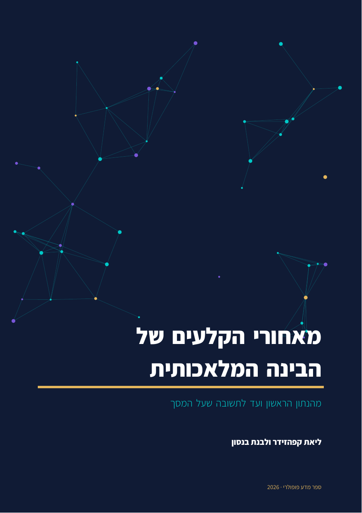
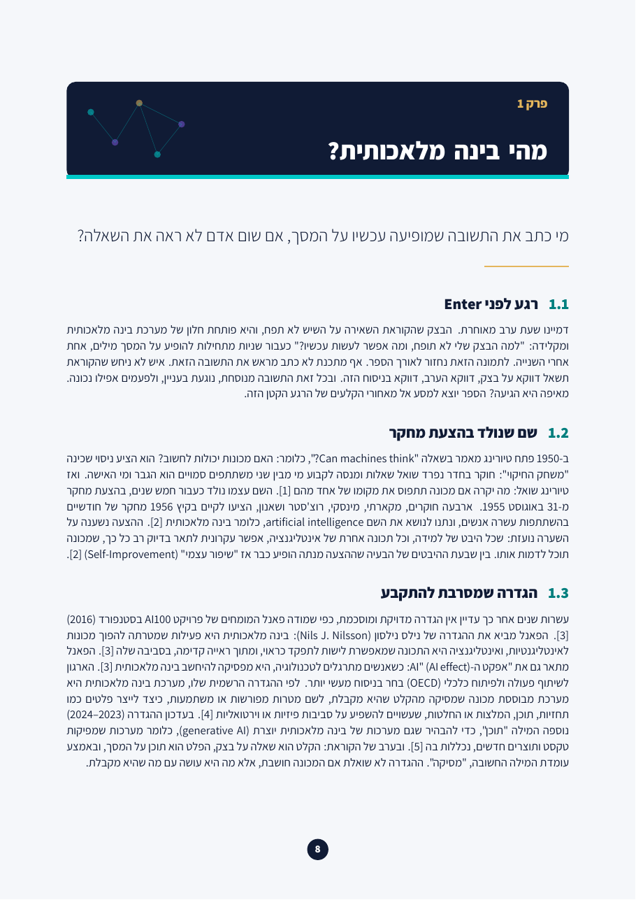
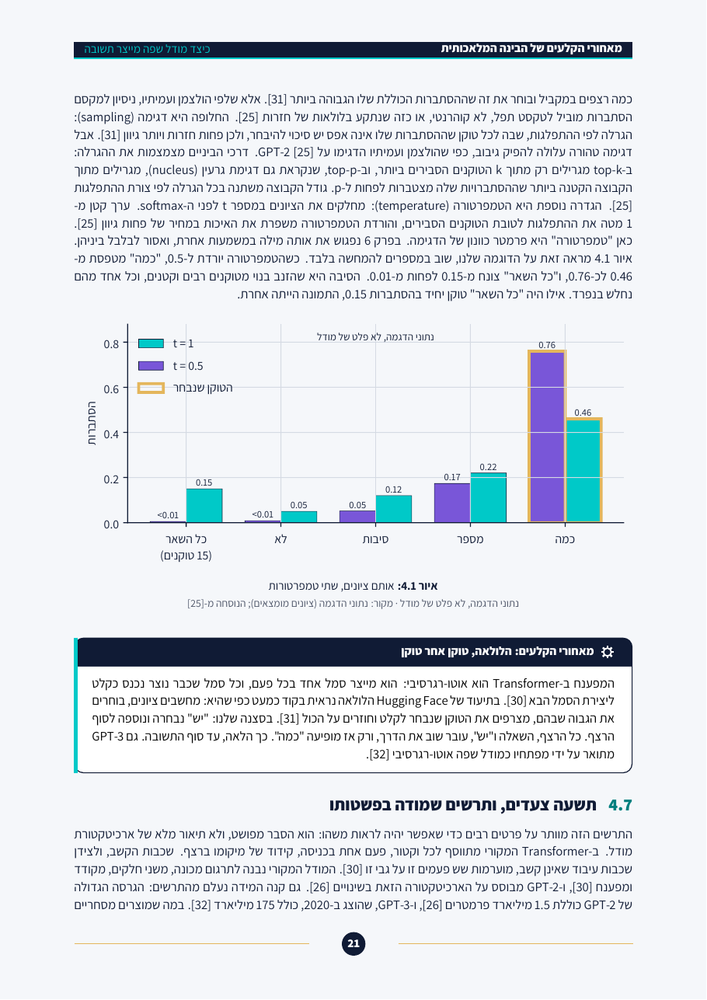
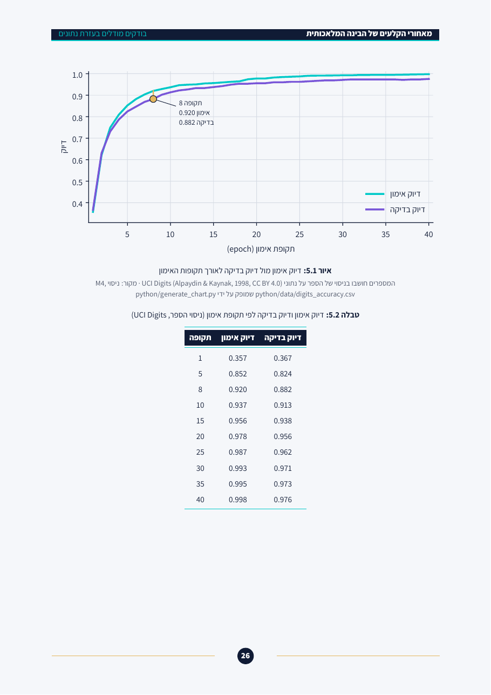
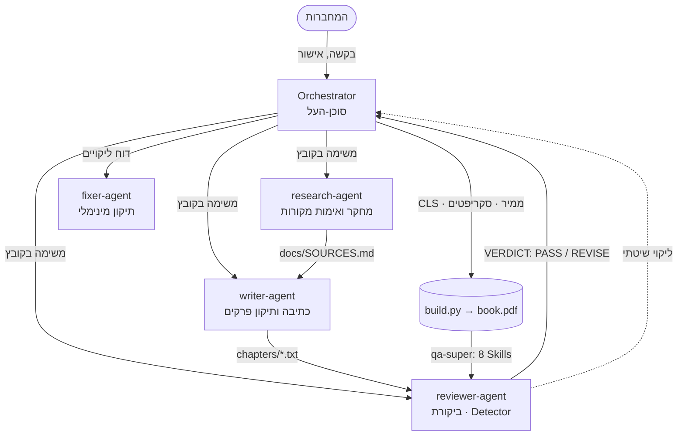
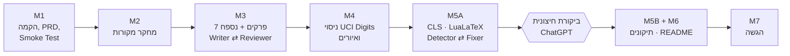
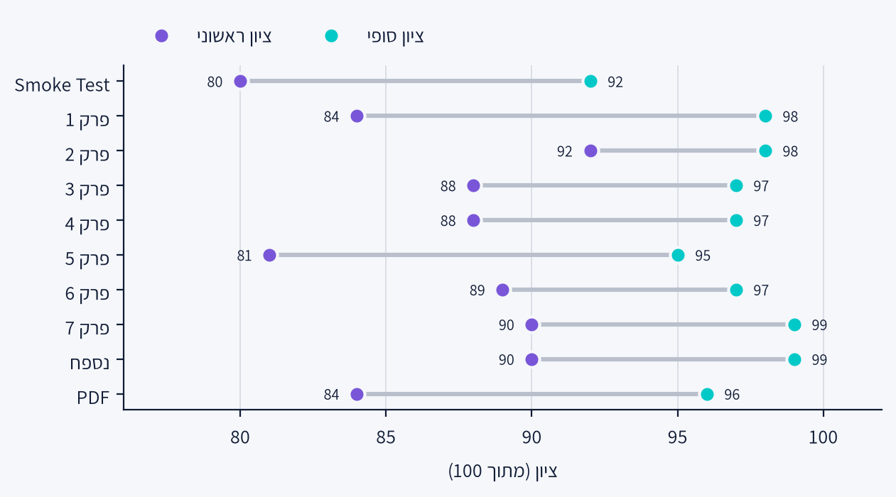
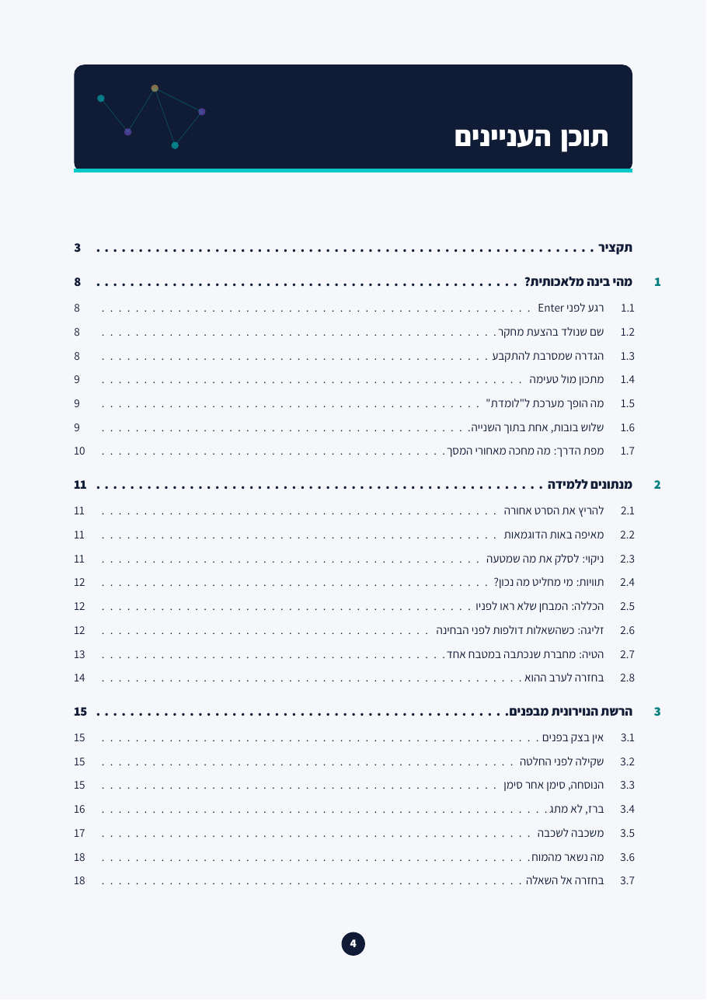
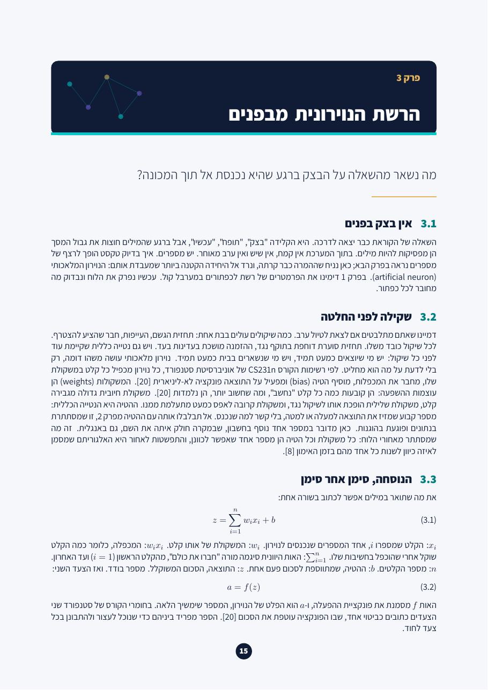
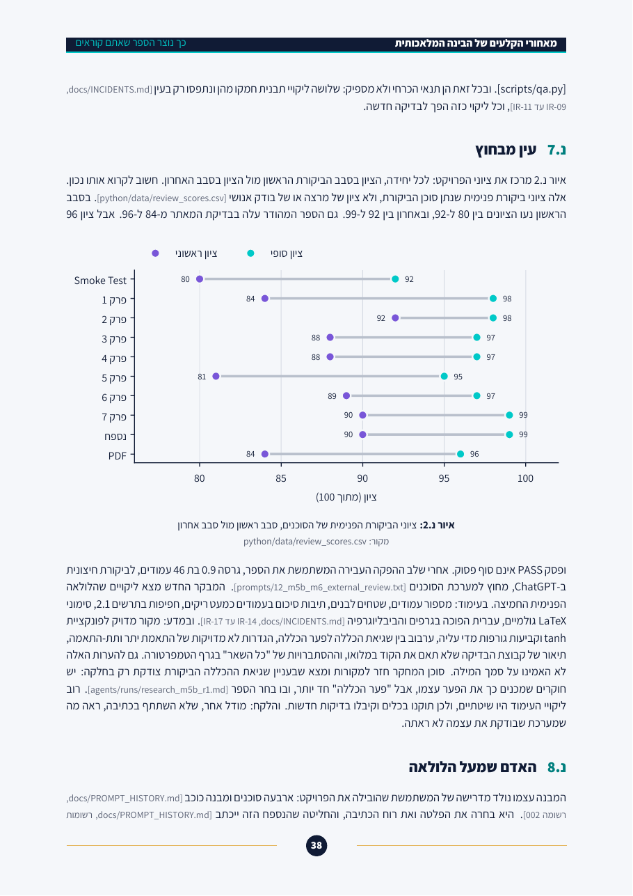

<div dir="rtl">

# מאחורי הקלעים של הבינה המלאכותית
### מהנתון הראשון ועד לתשובה שעל המסך

**מחברות:** ליאת קפהזידר ולבנת בנסון · **קוד קבוצה:** LIATLVNT · **מטלה:** 02

ספר מדע פופולרי בעברית (PDF, ‏43 עמודים) על הדרך שעוברת שאלה שהוקלדה לצ'טבוט, עד שעל המסך מופיעה תשובה. הספר נכתב, נבדק והודר במערכת של סוכני בינה מלאכותית (Claude Code), בהנחיית המחברות ובפיקוחן. כל שלב בתהליך מתועד בריפו הזה.

<p align="center">
  
  
  
  
</p>

| | |
|---|---|
| 📕 הספר | [`book.pdf`](book.pdf) (גרסה נוכחית), גרסאות קודמות ב-[`releases/`](releases/) |
| 🧭 סטטוס | [`docs/STATUS.md`](docs/STATUS.md) |
| 📜 שינויים | [`CHANGELOG.md`](CHANGELOG.md) |
| 🧯 תקלות | [`docs/INCIDENTS.md`](docs/INCIDENTS.md) (IR-01 עד IR-19) |

---

## 1. חזון הספר
הספר עוקב אחרי חוט עלילתי אחד: קוראת ששואלת מכונה למה הבצק שלה לא תפח. משם הוא יורד שכבה אחר שכבה: מה זו בינה מלאכותית (פרק 1), איך מכונה לומדת מנתונים (2), מה קורה בתוך רשת נוירונית (3), איך מודל שפה מייצר תשובה טוקן אחר טוקן (4), איך בודקים מודל (5), מה המכונה לא יודעת (6), ומה תפקידו של האדם (7). הנספח, "כך נוצר הספר שאתם קוראים", מספר איך הספר עצמו נבנה.

עקרונות המסמך המחייב (`docs/PRD.md`):
- **כל טענה עם מקור מאומת.** אין מקורות, נתונים או צילומי מסך מומצאים.
- **ניסוי אמיתי.** הגרף בפרק 5 מחושב בניסוי של הספר, ולא מנתונים מדומים.
- **כל המחשה נוצרת מקוד.** ‏Matplotlib ו-TikZ, בלי תמונות חיצוניות.
- **סגנון מדע פופולרי בקול מקורי:** פתיחה בשאלה, סיום בתובנות, וחמש תיבות תוכן קבועות.

## 2. ארכיטקטורת הסוכנים
חמישה סוכנים בארכיטקטורת כוכב. סוכן-העל מתאם, והסוכנים לא מדברים זה עם זה ישירות. כל המידע עובר דרך קבצים, כך שלכל שלב נשאר תיעוד.



| סוכן | תפקיד | כותב רק ל- |
|---|---|---|
| **Orchestrator** | מתכנן, מפעיל, בודק שערים (`git status`, ספירות, מזהים), מתעד. אינו כותב תוכן במקום הסוכנים | `docs/STATUS.md`, ‏`agents/runs/*` |
| **research-agent** | מאתר מקורות ומאמת אותם (DOI, רמת גישה, ציטוט ומיקום) | `docs/sources/`, ‏`docs/SOURCES.md` |
| **writer-agent** | כותב ומתקן פרקים על בסיס מקורות מאומתים בלבד | `chapters/*.txt` |
| **reviewer-agent** | ביקורת בלתי תלויה עם ציון ופסק. במצב **Detector** מאתר ליקויים ב-PDF המהודר | `agents/runs/review_*.md` |
| **fixer-agent** | מתקן במינימום שינוי לפי דוח. ליקוי שיטתי מוסלם לסוכן-העל ומתוקן בכלי, לא בטקסט | `chapters/*.txt` |

**כללים:** סוכן אחד בכל רגע; עד 3 סבבי תיקון ליחידה; כל דוח ביקורת מסתיים ב-`VERDICT: PASS` או `VERDICT: REVISE`; כל הפעלה מתועדת ב-`agents/runs/<agent>_<unit>_r<N>.md` (הפרומפט המלא והפלט הגולמי). הפרוטוקול: [`agents/orchestrator_agent.md`](agents/orchestrator_agent.md).

**Skills** (`.claude/skills/`, ‏13): חמישה נהלי סוכנים (`agent-*`) ושמונה בדיקות איכות (`qa-*`). הבדיקות הן קוד דטרמיניסטי (`scripts/qa.py`), שבודק כיווניות, טבלאות, קוד וניסוי, איורים, עימוד, תשתית וגרסת התבנית. `qa-super` מריץ את כולן.

## 3. תהליך הפיתוח


| שלב | מה נעשה | ראיות |
|---|---|---|
| M1 | PRD, ארכיטקטורת סוכנים, ‏Smoke Test (‏80 ← 92) | `agents/runs/smoke_test/` |
| M2 | 73 רשומות מקור, 61 שמישות; כל פרק עם 3 מקורות שמישים לפחות | `docs/SOURCES.md` |
| M3 | Writer ← Reviewer לכל פרק, commit לכל פרק שעבר | `agents/runs/m3_summary.md` |
| M4 | ניסוי מוגדר מראש, ‏3 גרפי Matplotlib ו-7 תרשימי TikZ | `python/`, ‏`latex/figures/` |
| M5A | תבנית `aibook.cls`, ממיר TXT ל-TeX, ‏IEEE, ‏Detector ‏84 ← Fixer ← ‏96 | `agents/runs/review_m5a_r2.md` |
| ביקורת חיצונית | ChatGPT מצא ליקויי עימוד ודיוקים מדעיים שהביקורת הפנימית פספסה | `prompts/12_m5b_m6_external_review.txt` |
| M5B + M6 | תיקונים בכלים, מקורות חדשים, נספח מורחב, Detector, ‏README | `agents/runs/*_m5b_*` |

### גרף השיפור: ציוני הביקורת הפנימית


> אלה **ציוני ביקורת פנימית של reviewer-agent**, בסבב הראשון ובסבב האחרון של כל יחידה. הם אינם ציון של מרצה או של בודק אנושי. הנתונים: [`python/data/review_scores.csv`](python/data/review_scores.csv).

## 4. תוצאות הניסוי (פרק 5)
מסווג MLP קטן (שכבה נסתרת אחת של 32 נוירונים) על **UCI Optical Recognition of Handwritten Digits**. מקור הנתונים: Alpaydin & Kaynak, 1998, ברישיון CC BY 4.0. העותק הוא `load_digits` של scikit-learn: ‏1,797 תמונות של 8×8 פיקסלים. כל ההגדרות נקבעו **לפני ההרצה** ב-[`python/experiment_config.json`](python/experiment_config.json): ‏seed ‏42, חלוקה של 75% אימון ו-25% בדיקה עם ריבוד, ‏40 תקופות. לניסוי אין קבוצת אימות. קבוצת הבדיקה נמדדת לדיווח בלבד.

| מדד | ערך |
|---|---|
| דוגמאות אימון / בדיקה | 1,347 / 450 |
| דיוק אימון בסוף (תקופה 40) | 0.998 |
| דיוק בדיקה בסוף (תקופה 40) | 0.976 |
| פער הכללה מוערך בסוף | 2.2 נקודות אחוז |
| הפער המרבי | 3.8 נקודות, בתקופה 8 (0.920 מול 0.882) |


שחזור: `python python/generate_chart.py` כותב את `python/data/digits_accuracy.csv`. הבדיקה `python scripts/qa.py code --rerun` מריצה את הניסוי מחדש ומשווה את התוצאה לקובץ השמור.

## 5. מבנה הפרויקט
```
ai_book_starter/
├── book.pdf                 # הספר (נוצר ב-build.py)
├── main.tex                 # מסמך-העל: כריכה, קרדיטים, תוכן, פרקים, ביבליוגרפיה
├── references.bib           # נוצר מ-chapters/*.txt (IEEE)
├── chapters/*.txt           # מקור האמת לתוכן (כותבים ומתקנים כאן)
├── latex/
│   ├── aibook.cls           # התבנית (v1.2.0, עם CHANGELOG פנימי)
│   ├── chapters/*.tex       # נוצרים מה-TXT, לא עורכים ידנית
│   ├── figures/*.tex        # תרשימי TikZ
│   └── layout_tight.tex     # נוצר ב-scripts/layout.py
├── python/                  # הניסוי, הגרפים והנתונים (data/)
├── assets/charts/           # גרפי Matplotlib (PDF + PNG)
├── scripts/                 # build, txt2tex, make_bib, qa, layout, screenshots
├── docs/                    # PRD, OUTLINE, STATUS, SOURCES, INCIDENTS, PROMPT_HISTORY, TODO, PLAN
├── agents/                  # הגדרות הסוכנים, runs/ (כל הרצה), tasks/ (משימות)
├── .claude/agents, skills/  # הגדרות תתי-הסוכנים ו-13 Skills
├── prompts/                 # הפרומפטים של המשתמשות, לפי הסדר
├── releases/                # גרסאות PDF משמעותיות
└── screenshots/             # צילומי מסך מתוך הספר
```

## 6. התקנה והידור
**דרישות:** Python 3.13, ‏TeX Live או MiKTeX עם LuaLaTeX, ‏biber ו-latexmk, ‏poppler-utils (`pdftotext`, ‏`pdfinfo`, ‏`pdftoppm`), והגופן **Assistant** (רישיון OFL).

```bash
python -m pip install -r requirements.txt
python scripts/build.py                 # גרפים → bib → TXT→TeX → LuaLaTeX+biber → book.pdf → QA
python scripts/build.py --experiment    # כולל הרצה מחדש של הניסוי
python scripts/qa.py super              # כל בדיקות האיכות → agents/runs/qa/qa_report.md
python scripts/screenshots.py           # צילומי מסך מעודכנים מתוך book.pdf
latexmk main.tex                        # הידור בלבד (LuaLaTeX, לפי .latexmkrc)
```
ב-Windows מריצים `python`, ולא `py`.

## 7. צילומי מסך
| | | |
|---|---|---|
|  |  |  |
| תוכן עניינים, עם מספור זהה ל-PDF | פרק 3: הנוסחה והסימון המתמטי | הנספח: איור נ.2 |

## 8. התפתחות הגרסאות
| תגית | commit | מה | PDF |
|---|---|---|---|
| v0.1 | `32317ba` | הקמה (M1) ומחקר מקורות (M2) | |
| v0.2 | `57f249d` | השלמת הכתיבה (M3): 7 פרקים ונספח | |
| v0.9 | `d5b7b50` | ספר מלא לפני הביקורת החיצונית (46 עמ') | [`releases/book_v0.9.pdf`](releases/book_v0.9.pdf) |
| v0.95 | commit של M5B | אחרי תיקוני הביקורת החיצונית (43 עמ') | [`releases/book_v0.95.pdf`](releases/book_v0.95.pdf) |
| v1.0 | | גרסת ההגשה, אחרי אישור המחברות | |

פירוט: [`CHANGELOG.md`](CHANGELOG.md).

## 9. ניהול משאבים וטוקנים
- **עד סוף M5A:** תועדו 51 הפעלות של תתי-סוכנים, ולשלוש מהן לא נרשם מספר טוקנים. סך הכול **3,511,855 טוקנים**:

  | סוכן | הפעלות | טוקנים |
  |---|---:|---:|
  | writer | 20 | 1,277,930 |
  | reviewer | 19 | 1,408,658 |
  | research | 11 | 722,285 |
  | fixer | 1 | 102,982 |
- **M5B:** research ‏137,008 (החלק שאחרי החידוש), ‏writer ‏137,161, ‏Detector: ראו `agents/runs/reviewer_m5b_r1.md`.
- **אמצעי חיסכון:**
  - סוכן אחד בכל רגע (אחרי HTTP 429, ‏IR-03).
  - קובצי משימה ועובדות במקום הדבקת הקשר ארוך.
  - בדיקות איכות בקוד במקום קריאה של מודל.
  - סבב Detector/Fixer אחד לכל הספר.
  - איחוד משימות של אותו סוכן להרצה אחת.
  - הניסוי רץ פעם אחת, ונבדק לשחזור רק בסוף.
- **נקודות התאוששות:** טבלת חבילות ב-`docs/STATUS.md` §0. אחרי ניתוק בודקים את `git status` וממשיכים מהחבילה הראשונה שלא הושלמה.

## 10. תקלות, פתרונות ולקחים
`docs/INCIDENTS.md` כולל 19 רשומות. כל רשומה מפרידה בין עובדות להשערות, ומסתיימת במניעה שיטתית. מבחר:

| # | תקלה | פתרון שיטתי |
|---|---|---|
| IR-01 | PDF ריק אחרי הידור "מוצלח" | סדר טעינה ב-CLS (tikz ו-tcolorbox לפני polyglossia) |
| IR-03, ‏04, ‏18 | ניתוק API, ‏HTTP 429, פקיעת התחברות | נקודות התאוששות; חידוש אותו סוכן; סוכן אחד בכל רגע |
| IR-05, ‏09 | תיבות ותרשימים זזו מחוץ לעמוד; תיבה שבורה איבדה מסגרת | מסגרת LTR מפורשת ב-CLS; תיבות לא נשברות |
| IR-12 | עובדה שגויה בקובץ העובדות של סוכן-העל | מספרים על הניסוי מחושבים מה-CSV ולא נכתבים ביד |
| IR-14 | עברית הפוכה בגרפים | ‏Matplotlib 3.11 מסדר עברית בעצמו; בדיקה התנהגותית ב-qa-img |
| IR-15 | תיבת תובנות לבדה בעמוד כמעט ריק | `scripts/layout.py` מסדר פרקים צפוף יותר באופן אוטומטי |
| IR-16 | ‏`x_i` ו-`\sum` כטקסט גולמי | סימון `$...$` בממיר; ‏qa-typeset נכשל על TeX גולמי |
| IR-19 | בנייה שנתקעה (לא שוחזרה) | מגבלת זמן לכל שלב ב-build.py |

**לקחים:**
1. **בדיקה אוטומטית היא תנאי הכרחי ולא מספיק.** ‏qa-super עבר נקי, וליקויים חזותיים נמצאו רק בבדיקה בעין, אצל Detector ואצל ChatGPT. כל ליקוי כזה הפך לבדיקה חדשה.
2. **ליקוי שחוזר מתקנים בכלי ולא בטקסט.** תיקון אחד בתבנית או בממיר תיקן את כל הפרקים בבת אחת.
3. **עין מבחוץ.** מודל אחר, שלא השתתף בכתיבה, מצא את מה שהביקורת הפנימית (‏96, ‏PASS) לא מצאה.
4. **התאוששות מתחילה במה שקיים בפועל** (`git status`, קבצים), ולא במה שזוכרים שנעשה.
5. **ציון פנימי הוא כלי בקרה ולא אישור איכות.** ההחלטה על הגשה נשארת אצל המחברות.

### בקרת איכות בגרסה v0.95
- **qa-super:** ‏**92 PASS · 0 WARN · 0 FAIL** (`agents/runs/qa/qa_report.md`). כולל את השחזור של הניסוי, שיצא זהה בית אחר בית.
- **שחזור הספר:** אחרי ניקוי מלא של קובצי הביניים, `build.py` הפיק ספר בן 43 עמודים עם טקסט זהה (השוואת hash של `pdftotext`).
- **Detector:** ‏93, ‏REVISE. שני הליקויים הבינוניים (D-m5b-01, ‏D-m5b-02) תוקנו, ואחריהם האימות האוטומטי עבר.

### ליקויים ידועים (קלים, אינם חוסמים הגשה)
| מזהה | ליקוי | סיבה |
|---|---|---|
| D-m5b-03 | נוסחאות ארוכות בתיבת המעבדה בפרק 3 נשברות בין שורות בפסקה מימין לשמאל | התיקון דורש שינוי בשבירת השורות של מתמטיקה בתוך RTL בממיר |
| D-m5b-06 | ברשומה [60] בביבליוגרפיה כתובת ה-URL נשברת אחרי "https:", ויש מילים בעברית בתוך רשומות באנגלית | נתוני ה-bib ושבירת URL. התיקון שיטתי (make_bib, ‏CLS) |

## 11. חבילת התיעוד החיצונית (ChatGPT)
> 📦 **מקום שמור.** כאן תשולב חבילת התיעוד החיצונית שהמחברות יצרו באמצעות ChatGPT: דוח הביקורת החיצונית על v0.9 וחומרי התיעוד הנלווים. הקבצים יתווספו לתיקייה `docs/external/`, והקישורים יופיעו כאן.

## 12. רישיונות וקרדיטים
- **נתונים:** UCI Optical Recognition of Handwritten Digits (Alpaydin & Kaynak, 1998), ‏CC BY 4.0.
- **גופן:** Assistant, ‏SIL Open Font License.
- **מקורות:** רשימה מלאה בסגנון IEEE בסוף הספר, ואינדקס עם רמת הגישה של כל מקור ב-`docs/SOURCES.md`.
- **הפקה:** Claude Code (Anthropic) בהנחיית המחברות.

</div>
