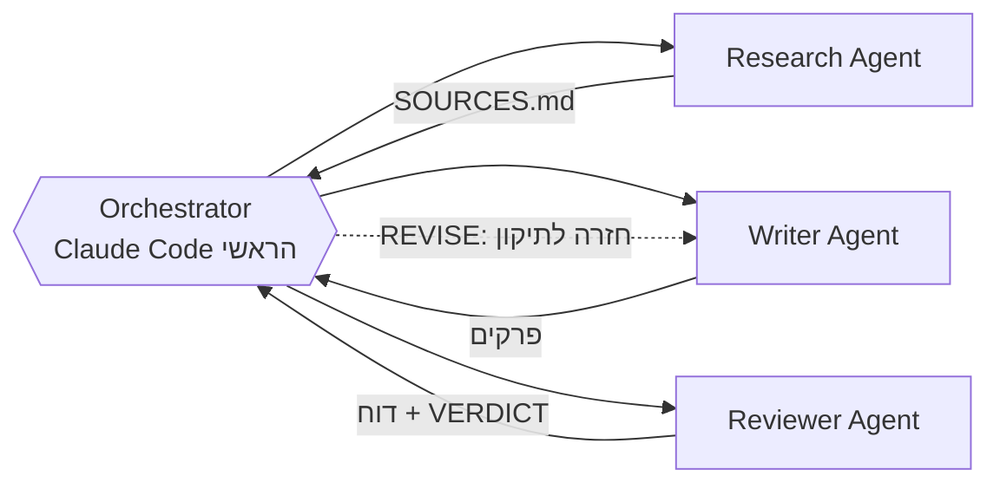

# מאחורי הקלעים של הבינה המלאכותית
### מהנתון הראשון ועד לתשובה שעל המסך

> **סטטוס: בפיתוח.** שלב M1 (הקמת הפרויקט) הושלם, וה-Smoke Test של הסוכנים עבר. שלב M2 (מחקר) בתהליך. הספר עצמו טרם נכתב.

## חזון
ספר דיגיטלי מעוצב בעברית המסביר באופן נגיש אך מדויק מה קורה בתוך מערכות בינה מלאכותית — מנתונים ואימון מודלים, דרך רשתות נוירונים ומודלי שפה, ועד להערכת תוצרים, מגבלות והשלכות חברתיות. הספר מופק כ-PDF באמצעות LaTeX (XeLaTeX) ו-Python. פירוט מלא: [`docs/PRD.md`](docs/PRD.md), מבנה הפרקים: [`docs/OUTLINE.md`](docs/OUTLINE.md).

## ארכיטקטורת סוכנים (Multi-Agent)
הספר מופק בתהליך שמנוהל על ידי ארבעה סוכנים:



| סוכן | הגדרה | תפקיד |
|---|---|---|
| **Orchestrator** | `CLAUDE.md`, `agents/orchestrator_agent.md` | סוכן-העל: מפעיל את שאר הסוכנים, מנהל את התלויות ואת סבבי התיקון ומתעד |
| **Research** | `.claude/agents/research-agent.md` | מקורות מאומתים, שנכתבים ל-`docs/SOURCES.md` |
| **Writer** | `.claude/agents/writer-agent.md` | כתיבת הפרקים, בלי גישה לרשת |
| **Reviewer** | `.claude/agents/reviewer-agent.md` | ביקורת שמסתיימת ב-`VERDICT: PASS/REVISE` |

**מחזור התיקון:** כש-Reviewer מחזיר `REVISE`, ה-Orchestrator מעביר את הליקויים ל-Writer (או ל-Research, כשמדובר בליקויי מקורות), ואחר כך שולח את התוצר לבדיקה חוזרת. מותרים עד 3 סבבים ליחידה. כל הרצה מתועדת ב-`agents/runs/`. שלושת הסוכנים כבר הופעלו בפועל ב-Smoke Test (`agents/runs/smoke_test/`).

## מבנה תיקיות
```text
.
├── README.md
├── CLAUDE.md                # הוראות ל-Orchestrator
├── .claude/agents/          # research-agent, writer-agent, reviewer-agent
├── main.tex                 # קובץ LaTeX ראשי (כרגע: שלד בדיקה)
├── requirements.txt         # תלויות Python
├── chapters/                # chapter_01.txt … chapter_07.txt (שלדים)
├── latex/
│   └── chapters/            # קובצי tex לפרקים (שלב M5)
├── python/
│   └── data/                # נתונים לגרף (שלב M4)
├── assets/
│   ├── charts/
│   ├── diagrams/
│   └── images/
├── agents/
│   ├── orchestrator_agent.md # ארכיטקטורה ופרוטוקול עבודה
│   ├── research_agent.md    # הגדרת תפקיד
│   ├── writer_agent.md      # הגדרת תפקיד
│   ├── reviewer_agent.md    # הגדרת תפקיד
│   └── runs/                # תיעוד הרצות בפועל (smoke_test/ ושלבי הספר)
├── docs/
│   ├── PRD.md
│   ├── OUTLINE.md
│   └── PROMPT_HISTORY.md
├── prompts/
│   └── 01_initialize_project.txt
└── screenshots/             # צילומי מסך מה-PDF הסופי (טרם נוצרו)
```

## דרישות מערכת
- **TeX:** הפצה עם XeLaTeX ו-latexmk (נבדק עם MiKTeX 25.12 ו-XeTeX 4.16 על Windows 11).
- **גופן עברי:** Assistant (רישיון SIL OFL), שמותקן במערכת. אפשר להוריד אותו מ-Google Fonts.
- **Python:** גרסה 3.10 ומעלה (נבדק עם 3.13.2). בשלב M4 נדרש matplotlib.

## הוראות הרצה (זמניות)
```bash
# הידור בדיקה של השלד
latexmk -xelatex main.tex
# ניקוי קבצי ביניים
latexmk -c

# התקנת תלויות Python (לשלבים הבאים)
python -m pip install -r requirements.txt
```
ההוראות יעודכנו כשיתווספו הגרף (`python/generate_chart.py`) והפקת `book.pdf`.

## צילומי מסך
יתווספו מתוך ה-PDF הסופי בשלב M6.
