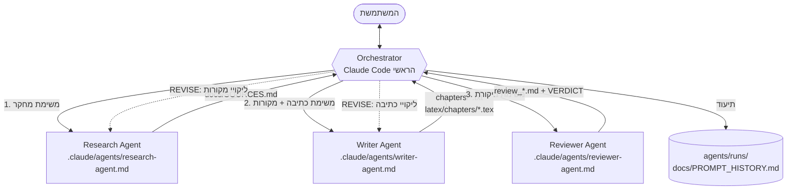
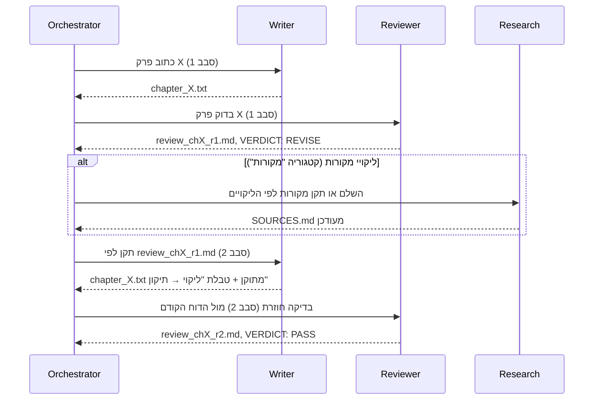

# Orchestrator Agent: סוכן-העל

> **מימוש:** Claude Code הראשי (הסשן שהמשתמשת עובדת מולו), לפי ההוראות ב-`CLAUDE.md`.
> **סטטוס:** הארכיטקטורה הוגדרה. תתי-הסוכנים **טרם הופעלו**.

## מטרה
לנהל את הפקת הספר מקצה לקצה בעזרת שלושה תתי-סוכנים עצמאיים. סוכן-העל מחליט מי עובד, על מה ומתי. הוא מעביר מידע בין הסוכנים, אוכף את שערי האיכות ומנהל את סבבי התיקון. הוא אינו מחליף את תתי-הסוכנים: את המחקר, הכתיבה והביקורת עצמם מבצעים הסוכנים הייעודיים.

## ארכיטקטורה

**מבנה כוכב (Hub-and-Spoke):** תתי-הסוכנים אינם מכירים זה את זה ואינם מתקשרים ישירות. כל תקשורת עוברת דרך סוכן-העל. כך גם פועל Claude Code בפועל, שבו תת-סוכן אינו יכול להפעיל תת-סוכן אחר. כל סוכן רץ בהקשר (context) נפרד ונקי, ומקבל רק את מה שסוכן-העל העביר לו בפרומפט ואת הקבצים שהוא מורשה לקרוא.

## תחומי אחריות
1. **הפעלה:** מפעיל כל תת-סוכן דרך כלי ה-Agent של Claude Code, עם `subagent_type` שתואם לשם הסוכן (`research-agent`, `writer-agent`, `reviewer-agent`).
2. **חלוקת משימות:** מפרק כל אבן דרך ליחידות עבודה (בדרך כלל פרק אחד או קבוצת פרקים) ומנסח לכל יחידה פרומפט ממוקד.
3. **ניהול תלויות:** Research ← Writer ← Reviewer. לא מפעיל את Writer על פרק שאין לו מקורות מאומתים, ולא מפעיל את Reviewer על פרק שעוד לא נכתב. יחידות בלתי תלויות, כמו מחקר לפרקים שונים, אפשר להריץ במקביל.
4. **העברת מידע:** ההעברה נעשית דרך **קבצים בריפו** (ראו חוזי הקלט והפלט בהמשך) ולא בזיכרון. בפרומפט מצוינים נתיבי הקלט, נתיבי הפלט ומספר הסבב.
5. **בקרת איכות (שער):** אחרי כל הרצה בודק שהקבצים הצפויים נוצרו, שהם בפורמט הנדרש ושלא נגעו בקבצים מחוץ לתחום של הסוכן. אם השער נכשל, הסוכן מורץ שוב, והכישלון מתועד.
6. **ניהול סבבי תיקון:** ראו "מנגנון החזרה לתיקון".
7. **תיעוד:** כל הפעלה נרשמת ב-`agents/runs/` וב-`docs/PROMPT_HISTORY.md`.
8. **הסלמה למשתמשת:** במקרה של החלטה עקרונית, ליקוי שלא נפתר אחרי 3 סבבים, או שינוי ב-PRD.

## חוזי קלט ופלט (Contracts)

| סוכן | קורא | כותב (ורק אותם) | אסור לו |
|---|---|---|---|
| Research | `docs/PRD.md`, `docs/OUTLINE.md`, `agents/research_agent.md` | `docs/sources/chapter_XX.md` (הרצה לפי פרק); `docs/SOURCES.md` (הרצת איחוד) | לערוך פרקים; להמציא מקורות |
| Writer | `docs/PRD.md`, `docs/OUTLINE.md`, `docs/SOURCES.md`, `agents/writer_agent.md`, דוח ביקורת (בסבב תיקון) | `chapters/chapter_XX.txt`, `latex/chapters/chapter_XX.tex` | לגשת לרשת; להוסיף מקור שאינו ב-`SOURCES.md`; לערוך את `SOURCES.md` |
| Reviewer | כל התוצרים, `docs/PRD.md` (סעיף 11), `agents/reviewer_agent.md` | `agents/runs/review_<unit>_r<N>.md` | לערוך פרקים או מקורות; לסמן "עובר" בלי בדיקה בפועל |

## מנגנון החזרה לתיקון (Revision Loop)

**כללים:**
1. כל דוח ביקורת מסתיים בשורה אחת שאפשר לפענח באופן מכונתי: `VERDICT: PASS` או `VERDICT: REVISE`.
2. הפסק REVISE ניתן כשיש לפחות ליקוי אחד ברמת חומרה **קריטי** או **בינוני**. ליקויים ברמת **קל** לבדם אינם מחייבים סבב נוסף, אבל הם מועברים ל-Writer.
3. סוכן-העל **מנתב** כל ליקוי לפי הקטגוריה שלו: ליקויים בקטגוריה "מקורות" הולכים ל-Research, וכל השאר הולכים ל-Writer.
4. בסבב התיקון Writer מקבל את נתיב הדוח, ומחזיר טבלה שבה לכל מזהה ליקוי מופיע התיקון שבוצע, או נימוק לאי-תיקון.
5. בבדיקה החוזרת Reviewer מקבל את הדוח הקודם, ומסמן לכל ליקוי אם תוקן, לא תוקן או תוקן חלקית.
6. **תקרה: 3 סבבים** לכל יחידה. אם אחרי סבב 3 עדיין אין PASS, סוכן-העל עוצר ומציג למשתמשת את הליקויים הפתוחים.

## תיעוד הרצות: `agents/runs/`
שם הקובץ: `<agent>_<unit>_r<N>.md`, כאשר `<agent>` הוא `research`, `writer` או `reviewer`. למשל `research_all_r1.md`, `writer_ch03_r2.md`, `reviewer_ch03_r2.md`.

> **הבחנה בין שני סוגי קבצים:** `reviewer_<unit>_r<N>.md` הוא קובץ ההרצה שסוכן-העל כותב (פרומפט ופלט גולמי). `review_<unit>_r<N>.md` הוא דוח הביקורת שה-Reviewer עצמו כותב. השמות שונים בכוונה, כדי שקובץ ההרצה לא ידרוס את הדוח.

כל קובץ כולל:
- תאריך, שם הסוכן, היחידה ומספר הסבב.
- **הפרומפט המלא** שסוכן-העל שלח.
- **הפלט הגולמי** שהסוכן החזיר, כלשונו וללא עריכה.
- רשימת הקבצים שנוצרו או שונו.
- תוצאת שער האיכות של סוכן-העל, וההחלטה על הצעד הבא.

דוחות הביקורת עצמם נכתבים על ידי Reviewer לאותה תיקייה. לא נוצר בה שום קובץ בלי הרצה בפועל.

## לקחים מה-Smoke Test (`agents/runs/smoke_test/README.md`)
1. **שער `git status`:** הוא עובד רק אחרי commit בסיסי. כשיש קבצים untracked משתמשים ב-snapshot של MD5.
2. **ניתוב ליקויים לפי מהות ולא רק לפי קטגוריה:** אם התיקון דורש טענה עובדתית שאין לה מקור, הליקוי עובר קודם ל-Research, גם כשהוא מסווג כ"סגנון".
3. **שמירת ראיות בסבבי תיקון:** התיקון נכתב לקובץ חדש (`_r2`) או מתועד ב-diff, כדי שאפשר יהיה לראות מה השתנה בין הסבבים.
4. **מחקר במקביל:** כל הרצה כותבת לקובץ נפרד (`docs/sources/chapter_XX.md`), ואחר כך הרצת איחוד בונה את `docs/SOURCES.md`. כך אין התנגשות כתיבה.
5. **ספירת מילים בעברית:** סופרים עם Python. `wc -w` ב-Git Bash שגוי.
6. **אחרי ניתוק:** אבחון לפי הקבצים בדיסק. משלימים רק את מה שחסר, ולא מריצים מחדש הפעלות שהושלמו.

## קריטריוני בדיקה לסוכן-העל
- [ ] כל אחד משלושת תתי-הסוכנים הופעל לפחות פעם אחת, ויש לכך תיעוד ב-`agents/runs/`.
- [ ] בוצע לפחות סבב תיקון אמיתי אחד (REVISE ← תיקון ← PASS), והוא מתועד.
- [ ] אף סוכן לא כתב מחוץ לתחום שלו.
- [ ] `docs/PROMPT_HISTORY.md` מתעד כל שלב.
